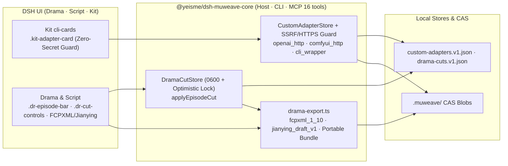

# Design: MuWeave DSH Custom Engine Bridge, Non-Destructive Cut & NLE Export v7

## Context & Architecture

v7 adds three cohesive capabilities on top of the tri-surface architecture without weakening any security or canonical-truth boundary:

## Key Technical Decisions

### 1. Zero-Secret Custom Engine Bridge (`capabilities/custom-adapters.ts`)
- **Persistence**: `pluginDataDir/custom-adapters.v1.json` (`schema: 'muweave.custom-adapters.v1'`), atomic `0600` write, `.corrupt-*` backup.
- **Zero-secret guarantee**: `authEnvVar` must match `/^[A-Z_][A-Z0-9_]{1,63}$/` when supplied; all fields pass `findPlaintextCredential`; `CustomAdapterViewV1` exposes `envReady: boolean` and never returns any env var value. `process.env[cfg.authEnvVar]` is read exclusively at `submit` time.
- **SSRF & transport guard (`validateAdapterEndpointUrl`)**:
  - Allows `http:` / `https:` only; unconditionally rejects `file:`, `gopher:`, `user:pass@`, `0.0.0.0`, and `169.254.*`.
  - Loopback (`127.0.0.1`, `localhost`, `::1`, `[::1]`) is permitted over `http:` or `https:`.
  - Private LAN ranges (`10.*`, `172.16-31.*`, `192.168.*`, `fc00::/7`, `fe80::/10`, `.local`) reject with `ADAPTER_PRIVATE_NET_FORBIDDEN` unless `allowPrivateNetwork === true`.
  - Non-loopback external endpoints must use `https:` (otherwise `ADAPTER_HTTPS_REQUIRED`).
- **Protocols & presets**: `openai_http` (`/v1/images/generations` → CAS PNG, `/v1/audio/speech` → CAS MP3), `comfyui_http` (`/prompt` + `/history` + `/view` → CAS PNG), `cli_wrapper` (no-shell `execFile` with safe binary regex); 3 built-in presets (`openai-image`, `openai-tts`, `comfyui-local`); zero-cost `testCustomAdapter` probe.
- **Standard safety gate**: Enabled custom adapters register into `CapabilityRegistry` and pass through `paidEnabled`, `dailyCap`, and human UI approval.

### 2. Multi-Episode Non-Destructive Cut Layer (`drama-cut-store.ts`)
- **Persistence**: `pluginDataDir/drama-cuts.v1.json` (`schema: 'muweave.drama-cuts.v1'`), atomic `0600` write, `.corrupt-*` backup.
- **Optimistic lock & validation**: Stale `expectedRevision` throws `muweave/cut_revision_conflict` with `{ currentRevision }`. Validates opaque `episodeRef`/`shotRef`, clamps durations to `200_000..300_000_000` microseconds, and enforces `findPlaintextCredential` + `containsHostPath`.
- **Pure overlay**: `applyEpisodeCut(rows, override)` filters `omittedShotRefs`, reorders via `shotOrder`, and overlays `durationOverridesMicros` and `transitions` (`cut | crossfade | dip_to_black`) without mutating `.muweave/` or `.scaena/**`.

### 3. FCPXML 1.10, Jianying Draft & Portable Bundle (`drama-export.ts`)
- Extends `DramaExportFormat` with `fcpxml_1_10` (`*.fcpxml`, `application/xml`) and `jianying_draft_v1` (`draft_content.json`, `application/json`).
- Applies optional `episodeRef` filtering and `EpisodeCutOverrideV1`, emits relative `media/<sha12>.<ext>` paths only (zero host paths/credentials).
- `exportDramaPortableBundle({ workspaceDir, exportResult, bundleDir, mediaBlobs })` copies verified CAS blobs into `bundleDir/media/` and writes a sanitized `README.txt`.

### 4. CLI, MCP (16 Tools) & v7 UI Surfaces
- **CLI (`cli.ts`)**: `muweave adapters list|add|remove|test`, `muweave cut show|reorder|trim|omit|reset`, `muweave export --episode --bundle-dir`, `muweave demo seed --episodes`.
- **MCP (`mcp/server.ts`)**: Adds `muweave_adapters_manage` and `muweave_drama_cut_manage` (16 tools total, still zero `job.approve`), and supports `episodeRef` + new formats in `muweave_drama_export`.
- **UI**: Drama & Script `.dr-episode-bar` switchers; Drama `.dr-cut-banner`, reorder/omit buttons, `ShotInspector` 「粗剪微调」, Timeline 「导出 FCPXML」 / 「导出剪映草稿」; Kit `.kit-adapter-card` inside `cli-cards` with client-side plaintext secret guard and 3 presets. All styles live in `styles.ts` using `--mw-*` tokens only.

## Verification Strategy

- `openspec validate muweave-dsh-bridge-cut-export-v7 --strict --no-interactive`
- `pnpm exec vitest run tests/custom-adapters.test.ts tests/drama-cut-export-v7.test.ts tests/v7-product-ui.test.tsx tests/muweave-mcp-server.test.ts tests/muweave-cli.test.ts tests/styles-static.test.ts`
- Full repo gate: `pnpm typecheck && pnpm test && pnpm build && pnpm pack:plugins && pnpm test:integration`
