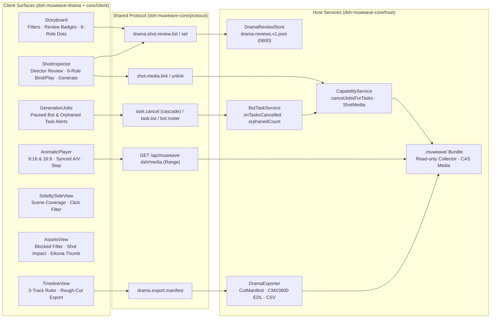

# Design: MuWeave DSH Drama Studio v2

## Context & Architectural Guardrails

Drama Studio v2 upgrades `@yeisme/dsh-muweave-drama` from a read-only viewer into a director review, 6-role shot media, animatic preview, and rough-cut handoff workstation while closing multi-agent orchestration P3 reliability gaps.

All changes strictly preserve five repository boundaries:
1. **No canonical DB mutation**: Director reviews persist exclusively in `pluginDataDir/drama-reviews.v1.json` (parallel to `schedule-store.ts` and `project-store.ts`). Canonical `.scaena/**`, `.eikona/**`, and `.auctra/**` internals are never touched.
2. **Buffered RPC & security gates**: All new actions live on the `/api/muweave-dsh/rpc` allowlist, return `{ ok, generation, hostInstanceId, data | error }`, enforce `findPlaintextCredential` + `containsHostPath` before write/return, and persist files atomically with mode `0600`.
3. **Stable room & stage tab contract**: `muweave-drama` keeps its 4 stage tab IDs (`storyboard`, `assets`, `timeline`, `side-by-side`) unchanged for keyboard shortcut and E2E selector compatibility.
4. **Token-only visual system**: All new CSS lives in `packages/dsh-muweave-core/src/client/styles.ts` using `--mw-*` tokens and `rem` lengths (except `1px`/`2px` hairlines), zero ad-hoc inline `style` (only dynamic CSS custom properties like `--dr-start`/`--dr-len`/`--mw-progress`), zero orange hues, `:focus-visible`, and `prefers-reduced-motion: reduce`.
5. **Externalized React 18 & zero media dependencies**: `AnimaticPlayer` uses native HTML5 `<video>` / `<audio>` and React 18 only.

## Architecture & Data Flow

## Key Technical Decisions

### 1. Optimistic-Locked `DramaReviewStore`
- **File**: `packages/dsh-muweave-core/src/drama-review-store.ts`
- **Persistence**: `path.join(pluginDataDir, 'drama-reviews.v1.json')`, schema `'muweave.drama-reviews.v1'`.
- **State machine**: `draft | in_review | needs_revision | approved | locked`. `locked` shots may be explicitly unlocked back to `in_review` or `needs_revision`, but stale `expectedRevision` is always rejected.
- **Validation**:
  - `shotRef`: non-empty opaque ID, `<= 128` chars, no `/`, `\`, or `..`.
  - `note`: `<= 500` chars; `tags`: `<= 8` items, each `<= 32` chars.
  - Both `note` and `tags` pass `findPlaintextCredential` and `containsHostPath`; violations throw `DramaReviewInputError('muweave/invalid_review_input', ...)`.
  - Revision mismatch throws `DramaReviewInputError('muweave/review_revision_conflict', ..., { currentRevision })`; initial creation accepts `expectedRevision === 0` or omitted.
- **Durability**: Atomic temp-file write (`0600`) + `renameSync`. Corrupt JSON is quarantined to `drama-reviews.v1.corrupt-<ts>.json` and surfaced via `corruptFile`.

### 2. Sanitized Rough-Cut Export Compiler (`drama-export.ts`)
- **Pure compiler**: `buildDramaExportPackage(input)` supports `cut_manifest_v1` (JSON), `cmx3600_edl` (plain text), and `shotlist_csv` (UTF-8 BOM RFC 4180 CSV).
- **Timecode calculation**: `msToSmpte(ms, fps)` supports `24 | 25 | 30` fps (default `24`), clamped to non-negative monotonic values derived from `plannedDurationMicros` / edit clips.
- **6-role media projection**: Only safe opaque identifiers (`sha256`, `elementId`, `mime`) are emitted; no local filesystem paths or raw prompts.
- **Exit gate**: Entire serialized output is checked against `containsHostPath` and `findPlaintextCredential` before returning from `drama.export.manifest`.

### 3. Multi-Agent Orchestration P3 Closure
- **`TaskLedger.list()`**: Adds `orphanedCount: number` counting `status === 'orphaned'` tasks in the active workspace.
- **Cascade cancellation**: `BotTaskService` accepts optional `onTasksCancelled?: (taskIds: readonly string[]) => Promise<string[]>`. `CreatorHostService` injects `(ids) => this.capabilities.cancelJobsForTasks(ids)`.
- **`CapabilityService.cancelJobsForTasks(taskIds)`**: Scans `this.engine.all()` for active jobs (`jobIsActive(job.status)`) whose `requester?.taskId` is in `taskIds`, attempts `this.engine.cancel(job.jobId)` per job (isolating individual errors so remaining jobs still cancel; ambiguous owner cancels remain `reconcile_required`), and returns `cancelledJobIds`.
- **UI visibility**: `GenerationJobs` reads `bot.roster` and `task.list` summaries and renders explicit text + tone alerts (`data-bot-paused-count`, `data-orphaned-task-count`) whenever paused bots or orphaned tasks exist.

### 4. Client Primitives & Drama Room Decomposition
- **`shot-media.tsx`**: Adds `SHOT_MEDIA_ROLE_LIST`, `mediaForRole`, `shotReadinessSummary`, and optional `capabilityId` / `label` on `ShotGenerateButton`.
- **`AnimaticPlayer`**: Controlled aspect ratio via `data-aspect="9:16" | "16:9"`, media playback via `/api/muweave-dsh/media` short-TTL grants, synchronized `<video>` / `` + `<audio>` (`voice`, `sfx`), prev/next step, scrub progress bar, timecode + review badge, and reduced-motion compliance.
- **`dsh-muweave-drama` decomposition**:
  - `shot-inspector.tsx`: Controlled inspector for 5-state review editing with conflict recovery, 6-role media preview/playback/link/unlink, Eikona element picker, and `GenerationDrawer` prefill with `anchor: { episodeRef, sceneRef, shotRef }`.
  - `timeline-view.tsx`: Export toolbar (`EDL` / `JSON` / `CSV`), 3-track synchronized ruler (visual/video, voice, sfx/music), click-to-inspect clips, and clip detail table.
  - `side-by-side-view.tsx`: Auctra scene cards with `N shots · X.Xs · M/N approved` badges, explicit `data-scene-uncovered="true"` gap badge for 0-shot scenes, and click-to-filter shot list.
  - `assets-view.tsx`: `All / Blocked / Ready` filter, Eikona `master_binding` thumbnail linkage, and reverse-lookup chips of impacted `shotRef`s that open `ShotInspector`.

## Verification Strategy

- `openspec validate muweave-dsh-drama-studio-v2 --strict --no-interactive`
- Unit & integration tests: `tests/drama-review-store.test.ts`, `tests/drama-export.test.ts`, `tests/drama-production-ui.test.tsx`, `tests/bot-cascade-cancel.test.ts`, plus existing `tests/styles-static.test.ts`
- Full repo gate: `pnpm typecheck && pnpm test && pnpm build && pnpm pack:plugins && pnpm test:integration`
