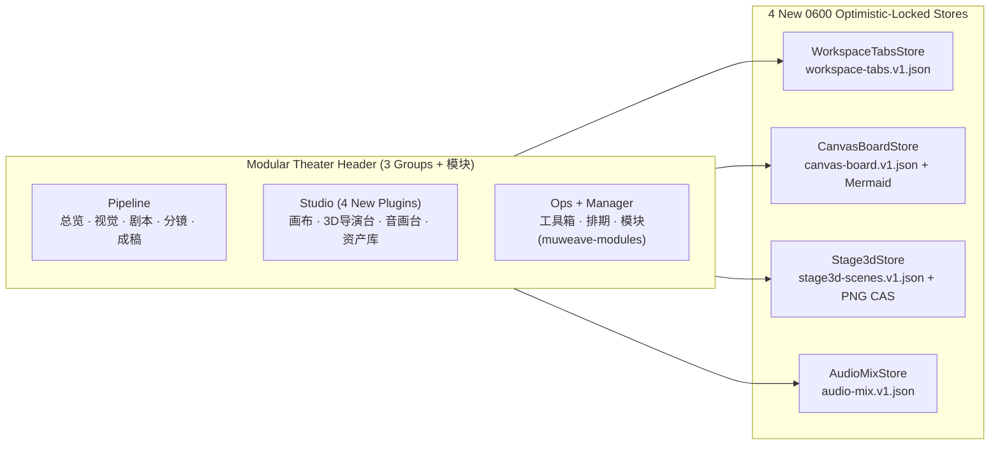

# Design: MuWeave DSH Modular Header Architecture & 4 Studio Tabs v9

## Context & Architecture

v9 scales MuWeave DSH from 6 plugins (7 rooms) to **10 DSH plugin packages (11 plugin rooms + 1 built-in `muweave-modules` view = 12 rooms)** organized into 3 header groups (`pipeline`, `studio`, `ops`) with per-workspace customizable tab visibility and ordering.

## Key Technical Decisions

### 1. Modular Header & `ModuleManagerPage` (`core/client/theater/`)
- `TheaterRoom.group`: `'pipeline' | 'studio' | 'ops'` (default inferred by room ID).
- `THEATER_MODULES_VIEW_ID = 'muweave-modules'` is rendered inside `TheaterPage` when active without adding it to `getTheaterRooms()`.
- `module-manager.ts` stores `{ preset, pinnedRoomIds, orderIds, revision }` in `globalThis` + `localStorage` (`muweave.theater.tabs.v1`) and syncs via `workspace.tabs.get|save|reset`.
- 5 role presets (`all`, `director`, `art_canvas`, `audio_edit`, `producer`); `resolveVisibleHeaderRooms` keeps any currently active unpinned room visible; `Alt+1..9` targets the first 9 visible header rooms in customized order.

### 2. Four Persistent Stores & 13 RPCs (`packages/dsh-muweave-core`)
All four stores use `0600` atomic tmp+rename, `.corrupt-<ts>` quarantine, `expectedRevision` optimistic locking, and `findPlaintextCredential` + `containsHostPath` checks:
- `WorkspaceTabsStore` (`workspace-tabs.v1.json`, `muweave/tabs_revision_conflict`)
- `CanvasBoardStore` (`canvas-board.v1.json`, `muweave/canvas_revision_conflict`) + pure `exportCanvasMermaid(board)`
- `Stage3dStore` (`stage3d-scenes.v1.json`, `muweave/stage3d_revision_conflict`) + pure `compileStage3dPrompt(scene)` & `detectAxisCrossing(prev, cur)`
- `AudioMixStore` (`audio-mix.v1.json`, `muweave/audio_revision_conflict`, clamps `gainPct` `0..150` and `fadeInMs/fadeOutMs` `0..10000`)
- **`stage3d.snapshot.save`**: Validates `data:image/png;base64,`, decoded size `> 8 && <= 2_097_152` bytes, and 8-byte PNG magic (`89 50 4e 47 0d 0a 1a 0a`), stores via `putCasBlob`, and optionally links via `addShotMediaLink` (`role: 'reference'`).

### 3. Four Standalone Studio Plugins (Zero External Media/Graph Deps)
- **`@yeisme/dsh-muweave-canvas`** (`muweave-canvas`, `order: 44.6`, tabs: `board`, `outline`): Pan/zoom spatial board (`--mw-x`/`--mw-y`/`--mw-w`/`--mw-h`/`--mw-zoom`), auto-layout from current episode, node/edge editor, Mermaid export.
- **`@yeisme/dsh-muweave-stage3d`** (`muweave-stage3d`, `order: 44.7`, tabs: `director-stage`, `camera-sheet`): Pure Canvas2D 3D perspective projection (`projection3d.ts`), 5 camera presets, top-down floorplan, 180° axis-crossing alert, structured camera prompt, greybox PNG snapshot bind.
- **`@yeisme/dsh-muweave-audio`** (`muweave-audio`, `order: 44.8`, tabs: `mixer`, `cues`): Master + 3-track (`voice`/`music`/`sfx`) mute/solo/gain/fade mixer, missing-voice TTS trigger, dialogue cues with `>8s` lip-sync drift badge, SRT/VTT export.
- **`@yeisme/dsh-muweave-assets`** (`muweave-assets`, `order: 44.9`, tabs: `catalog`, `usage`): Cross-domain asset vault with category filters, 4-axis readiness dots, bind-to-shot, `@` staging, and bidirectional asset↔shot usage matrix.

### 4. CLI, MCP (22 Tools / 12 Resources) & Style Guard
- CLI adds `muweave tabs show|preset|reset`, `muweave canvas show|export-mermaid`, `muweave stage3d show|export-prompts`, `muweave audio show`.
- MCP adds `muweave_workspace_tabs`, `muweave_canvas_board`, `muweave_stage3d_scene`, `muweave_audio_mix` (22 tools, zero `job.approve`) and `muweave://workspace/tabs`, `muweave://canvas/board`, `muweave://stage3d/scenes`, `muweave://audio/mix` (12 resources).
- `tests/styles-static.test.ts` expands to guard all 10 plugin packages with zero ad-hoc inline styles or literal hex colors.

## Verification Strategy

- `openspec validate muweave-dsh-modular-studio-tabs-v9 --strict --no-interactive`
- `pnpm exec vitest run tests/v9-modular-stores.test.ts tests/v9-modular-studio-ui.test.tsx tests/styles-static.test.ts tests/theater.test.tsx tests/muweave-mcp-server.test.ts`
- Full repo gate: `pnpm typecheck && pnpm test && pnpm build && pnpm pack:plugins && pnpm test:integration` (10 plugins installed offline + 5 new v9 screenshots).
