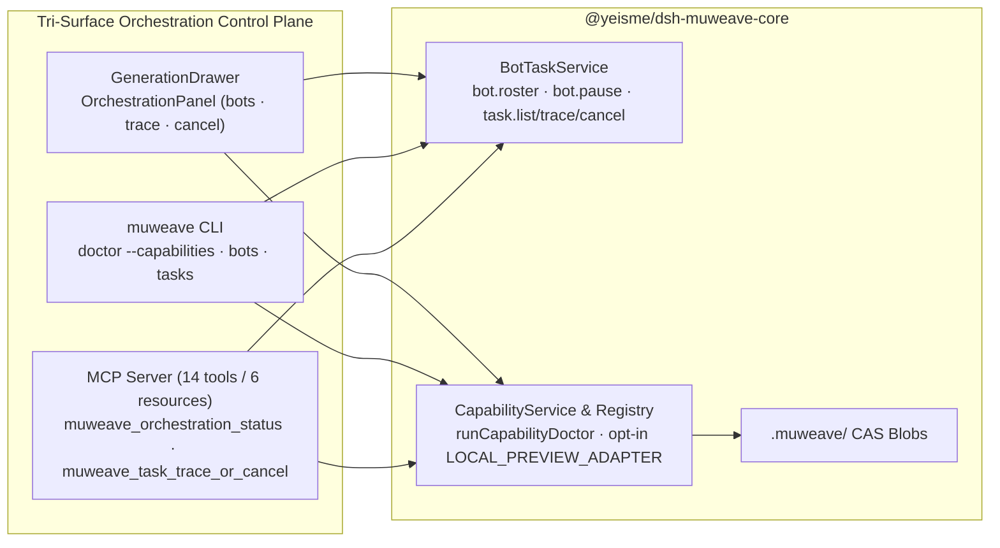

# Design: MuWeave DSH Orchestration Control Plane & Open Engine Ecosystem v6

## Context & Architecture

v6 closes the operational loop across UI, CLI, and MCP for multi-agent bot orchestration while lowering the onboarding barrier for open-engine integrators through a zero-cost capability doctor and an opt-in local preview adapter.

## Key Technical Decisions

### 1. Capability Doctor (`capabilities/doctor.ts`)
- `runCapabilityDoctor(catalog, workspaceSummary?)` inspects the capability catalog without making any paid calls or leaking host paths/credentials.
- Returns `{ ok: true, availableCount, blockedCount, paidEnabled, capabilities: [{ capabilityId, owner, stage, available, reason?, remediation }] }` with explicit remediation guidance for `NO_COST_CAP`, `NO_SUBMIT_COMMAND`, `ADAPTER_PENDING`, `OWNER_NOT_INSTALLED`, `MARKER_MISSING`, and `PAID_DISABLED_BY_HOST`.
- Exposed via `muweave doctor --capabilities [--json|--agent]`.

### 2. Opt-In Zero-Cost Local Preview Adapter (`capabilities/preview-adapter.ts`)
- Defines `LOCAL_PREVIEW_ADAPTER` (`capabilityId: 'demo.image.preview'`, `owner: 'eikona'`, `kind: 'image'`, `stage: 'visual'`, `costClass: 'free'`, `costUnit: 'none'`, `defaultSlots: 2`, `maxSlots: 4`).
- Dynamically registered in `CapabilityRegistry` **only** when `process.env.MUWEAVE_LOCAL_PREVIEW_ADAPTER === '1'` (strictly OFF by default).
- Generates deterministic minimal PNGs tinted from the prompt digest, stores them in CAS via `putCasBlob`, and completes the full free lifecycle (`estimate → request → approve → slot review → linkToShot`) with zero external provider calls.

### 3. Tri-Surface Orchestration Control Plane
- **UI (`orchestration-panel.tsx`, `generation.tsx`)**:
  - `GenerationDrawer` adds a compact top segmented switcher (`data-generation-drawer-tabs="true"`): `生成任务` (`jobs`, default—preserves all existing E2E selectors) and `编排与断路器` (`orchestration`).
  - `OrchestrationPanel` loads `bot.roster` and `task.list` in parallel; renders bot circuit-breaker toggles (`bot.pause` with `expectedRevision` & `idempotencyKey`), `orphanedCount` warnings, expandable `task.trace` summaries, and `task.cancel` cascade receipts (`cancelledTaskIds` + `cancelledJobIds`).
- **CLI (`cli.ts`)**: Adds `muweave bots list|pause|resume` and `muweave tasks list|trace|cancel`, sanitized with `stripHostPaths`.
- **MCP (`mcp/server.ts`)**: Adds `muweave_orchestration_status` and `muweave_task_trace_or_cancel` (14 tools total, zero `job.approve`) plus `muweave://orchestration/tasks` resource (6 resources total).

### 4. Workbench Visual Closure & E2E Screenshots
- `packages/dsh-muweave-workbench/src/client.tsx`: Uses `unavailableReasonLabel(entry.blockedReason, lang)` in the rightbar tool catalog while preserving raw codes in `data-reason` and `title`.
- `packages/dsh-muweave-workbench/src/stage-workbench.tsx` & `styles.ts`: Places `<kbd>C</kbd>` cleanly inside the `对比基线` button and ensures `.mw-stage-primary-body` / `.mw-stage-primary-actions` wrap cleanly (`min-width: 0; flex-wrap: wrap`) at `1440px` and `1024px`.
- `scripts/inner-e2e-runner.mjs`: Adds `1440×900` captures for `kit-cli-mcp`, `shortcuts-modal`, `drama-inspector-open`, and `orchestration-drawer`.

## Verification Strategy

- `openspec validate muweave-dsh-orchestration-ecosystem-v6 --strict --no-interactive`
- `pnpm exec vitest run tests/capability-doctor-preview.test.ts tests/orchestration-panel.test.tsx tests/styles-static.test.ts tests/stage-keyboard.test.tsx`
- Full repo gate: `pnpm typecheck && pnpm test && pnpm build && pnpm pack:plugins && pnpm test:integration`
