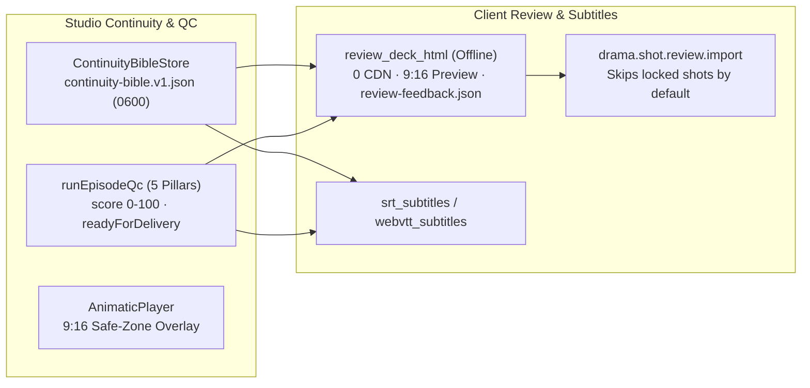

# Design: MuWeave DSH Continuity Bible, Automated QC Gate & Offline Client Review Deck v8

## Context & Architecture

v8 completes the vertical-drama studio delivery loop by uniting visual/character continuity, automated zero-cost pre-delivery QC, 9:16 safe-zone framing, subtitle compilation, and offline client review round-tripping across UI, CLI, and MCP.

## Key Technical Decisions

### 1. Continuity Bible (`continuity-bible-store.ts`, `project.bible.get/set`)
- Persisted in `pluginDataDir/continuity-bible.v1.json` (`0600` atomic write, `.corrupt-<ts>` backup).
- Stores `aspectRatio`, `lensStyle`, `lightingRule`, `styleDirective`, `negativeGuardrails`, `complianceDisclosure`, `paletteHexes` (validated against `/^#[0-9a-fA-F]{6}$/`), and `characterAnchors` (`name`, `wardrobe`, `immutableTraits`).
- Enforces `findPlaintextCredential` + `containsHostPath` (`muweave/invalid_bible_input`) and `expectedRevision` optimistic locking (`muweave/bible_revision_conflict`).
- Mounted in Eikona's existing `masters` tab (`.mw-bible-card`) with save and `@` floating-agent staging.

### 2. Automated Episode QC Gate (`drama-qc.ts`, `drama.qc.report`)
- Pure zero-cost compiler evaluating the active non-destructive cut (`applyEpisodeCut`), reviews, 4-axis asset readiness, optional `ContinuityBibleV1`, and optional `hasCasBlob`:
  1. **Opening hook & pacing**: 0 shots → blocker `qc_empty_episode`; shot #1 `> 3500ms` → warning `qc_opening_hook_slow`; total `< 5000ms` or `> 300000ms` → warning `qc_episode_duration_range`.
  2. **Media & lip-sync**: missing keyframe & video → blocker `qc_shot_missing_visual`; missing audio → warning `qc_shot_missing_audio`; `voice` with duration `> 8000ms` → warning `qc_shot_lipsync_risk`; missing CAS blob → blocker `qc_cas_blob_missing`.
  3. **Asset readiness**: blocked 4-axis assets → warning `qc_asset_axis_blocked`.
  4. **Director review gate**: `draft` → blocker `qc_shot_unapproved`; `needs_revision` → blocker `qc_shot_needs_revision`.
  5. **Compliance**: missing `complianceDisclosure` → warning `qc_missing_compliance_disclosure`.
- Clean pillars emit `pass` findings; `score = clamp(0, 100, 100 - 15*blocker - 5*warning)`; `readyForDelivery = counts.blocker === 0 && shotCount > 0`.

### 3. Offline Review Deck HTML, Safe Feedback Import & Subtitles (`drama-export.ts`, `drama-review-store.ts`)
- **`srt_subtitles` & `webvtt_subtitles`**: Deterministic timestamps compiled from the active cut and shot dialogue/subtitle cells.
- **`review_deck_html`**: Self-contained offline HTML (`*-review-deck.html`) with zero external CDNs/fonts, HTML & `</script>`-escaped JSON state, 9:16 preview referencing `media/<sha12>.<ext>` + fallback poster, compliance badge, per-shot `approved`/`needs_revision` + note controls, and client-side `review-feedback.json` download. `--bundle-dir` also writes `subtitles.srt`, `media/`, and `README.txt`.
- **`DramaReviewStore.importFeedback` (`drama.shot.review.import`)**: Validates credentials/host paths/statuses, skips currently `locked` shots (`skipped_locked`, `'locked_by_director'`) unless `allowLocked === true`, and commits in a single atomic write.

### 4. 9:16 Safe-Zone Overlay & Tri-Surface Sync
- `AnimaticPlayer` adds opt-in `data-animatic-safezone-toggle="true"` toggling non-interactive `.dr-safe-zone-overlay` (top margin, right engagement rail, bottom caption zone, dashed center safe frame) using `--mw-*` tokens only.
- CLI adds `muweave bible show|set`, `muweave qc [--episode] [--strict]`, `muweave review import`, `muweave export srt_subtitles|webvtt_subtitles|review_deck_html`.
- MCP grows to **18 Tools / 8 Resources / 3 Prompts** (`muweave_project_bible`, `muweave_drama_qc_report`, `muweave://project/bible`, `muweave://drama/qc`), still zero `job.approve`.
- `demo-seed.ts` normalizes episode 1 `episodeRef` to `'episode:01'`, includes sample dialogue/subtitle cells, and seeds a default `ContinuityBibleV1` with `complianceDisclosure`.

## Verification Strategy

- `openspec validate muweave-dsh-qc-bible-review-deck-v8 --strict --no-interactive`
- `pnpm exec vitest run tests/continuity-bible.test.ts tests/drama-qc-review-deck.test.ts tests/v8-qc-safezone-ui.test.tsx tests/styles-static.test.ts`
- Full repo gate: `pnpm typecheck && pnpm test && pnpm build && pnpm pack:plugins && pnpm test:integration`
