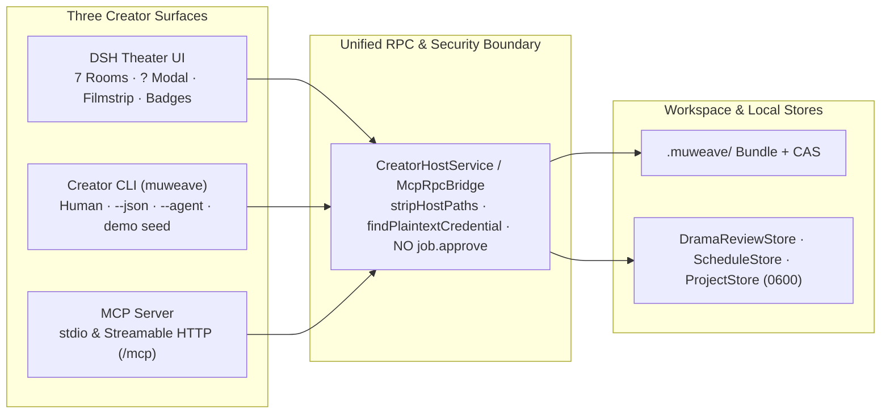

# Design: MuWeave DSH Tri-Surface CLI, MCP & UX v5

## Context & Tri-Surface Architecture

MuWeave DSH v5 unifies three creator surfaces—**DSH Web/Theater UI**, **Creator CLI (`muweave`)**, and **MCP Server (Local stdio + Remote Streamable HTTP)**—over the single `CreatorHostService` RPC boundary and `.muweave/` materialized bundle contract.

## Key Technical Decisions

### 1. Creator CLI & Self-Contained Demo Showcase (`cli.ts`, `demo-seed.ts`)
- **`seedDemoWorkspace(workspaceDir, { force, pluginDataDir })`**: Generates `"雨夜怀表 · 第 1 集"` with 3 Auctra scene cards, dual timeline, 1 stale candidate diff, 6 Scaena 9:16 storyboard shots (including tiny valid PNG blobs stored in CAS via `putCasBlob`), 4-axis asset readiness table (1 blocked asset), edit timeline, 1 Eikona candidate group + master binding, plus optional `DramaReviewStore` & `ScheduleStore` records. Refuses to overwrite non-empty `.muweave/` unless `force: true` and guarantees `validateBundleOnDisk()` passes.
- **Output contracts**: Human-readable default, `--json`, and `--agent` (`spec_version=1.0`, `fact.*` / `action.*` / `error.*`). All structured outputs pass `stripHostPaths` and `findPlaintextCredential`.

### 2. Zero-Dependency Local & Remote MCP Server (`mcp/server.ts`, `mcp/http.ts`)
- **Protocol**: MCP JSON-RPC 2.0 (`2024-11-05` & `2025-03-26`) supporting `initialize`, `notifications/initialized`, `ping`, `tools/list`, `tools/call`, `resources/list`, `resources/read`, `prompts/list`, and `prompts/get`.
- **Transport modes**:
  - **Local stdio** (`runStdioMcpServer`): Supports both newline-delimited JSON-RPC and `Content-Length` framing; logs exclusively to `stderr`.
  - **Remote Streamable HTTP** (`startMuweaveMcpHttpServer`): Built on `node:http` (default `127.0.0.1:3741`). Routes: `GET /healthz`, `OPTIONS /mcp`, `POST /mcp` (1 MiB body cap, `Mcp-Session-Id`, HTTP 200 JSON / 202 notification), `GET /mcp` (SSE `text/event-stream`), `DELETE /mcp` (204).
- **Mandatory Remote Security Gate**:
  - Binding to any non-loopback host (`host !== '127.0.0.1' && host !== 'localhost' && host !== '::1'`) without `authToken` (or `MUWEAVE_MCP_TOKEN`) MUST fail fast with `REMOTE_AUTH_TOKEN_REQUIRED`.
  - When configured, `/mcp` verifies `Authorization: Bearer <token>` using `crypto.timingSafeEqual` and returns HTTP `401` on mismatch.
  - Proxy mode (`--host-url`) forwards to `/api/muweave-dsh/rpc` without ever logging bearer tokens.
- **Tool/Resource/Prompt Surface**:
  - 12 sanitized tools: `muweave_workspace_status`, `muweave_bundle_sync`, `muweave_elements_list`, `muweave_element_get`, `muweave_drama_shots_list`, `muweave_drama_review_set`, `muweave_drama_review_batch`, `muweave_drama_export`, `muweave_schedule_manage`, `muweave_project_diagnose`, `muweave_capability_estimate`, `muweave_job_request_or_status` (creates `waiting_approval` only; `job.approve` is never exposed).
  - 5 `muweave://*` resources: `workspace/overview`, `drama/storyboard`, `drama/timeline/edl`, `script/scenes`, `schedule/board`.
  - 3 prompts: `drama_director_review`, `drama_shot_breakdown_9x16`, `eikona_character_turnaround`.

### 3. DSH Kit Agent Sync & Config Cookbook (`packages/dsh-muweave-kit`)
- Registers 4 narrow `role: 'agent'` tools in `muweave-creator` (`muweave_drama_shots_list`, `muweave_drama_review_set`, `muweave_drama_export`, `muweave_project_diagnose`) backed by `service.handleRpcAction(...)` with zero `job.approve` exposure, plus runtime skill `muweave-cli-mcp-assist`.
- Embeds `.kit-mcp-card` (`data-kit-mcp-card="true"`) inside the existing `cli-cards` tab with CLI copy snippets and 3-mode MCP config tabs (`本地 stdio`, `远程 HTTP 服务`, `联机回环代理`) using `${workspaceFolder}` and `<your-mcp-token>` placeholders only.

### 4. v5 UX Polish (`@yeisme/dsh-muweave-core/client` & `@yeisme/dsh-muweave-drama`)
- `?` `ShortcutsHelpModal` (`role="dialog"`, `aria-modal="true"`, Escape closes & restores focus, ignores editable targets).
- `publishTheaterRoomBadges` / `useTheaterRoomBadges` rendering `.mw-room-badge` in `TheaterPage` (e.g., Drama `needs_revision` count).
- `FloatingAgentOverlay`: per-chip `×` removal (`removeStagedItemFromFloatingAgent`) and room-aware quick prompt chips (`.mw-float-quick-chips`).
- `ShotInspector` bottom `.dr-filmstrip`, storyboard keyword search (`data-drama-shot-search="true"`), and Timeline Markdown review summary copy (`data-drama-copy-review-md="true"`).
- All new styles centralized in `styles.ts` using `--mw-*` tokens, `rem` units, `:focus-visible`, and `prefers-reduced-motion: reduce`.

## Verification Strategy

- `openspec validate muweave-dsh-tri-surface-v5 --strict --no-interactive`
- `pnpm exec vitest run tests/muweave-cli.test.ts tests/muweave-mcp-server.test.ts tests/ux-v5-polish.test.tsx tests/styles-static.test.ts tests/plugins.test.tsx`
- Full repo gate: `pnpm typecheck && pnpm test && pnpm build && pnpm pack:plugins && pnpm test:integration`
